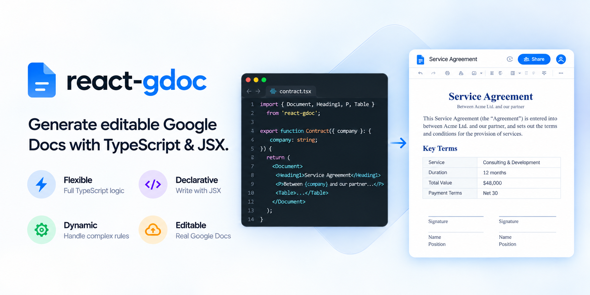
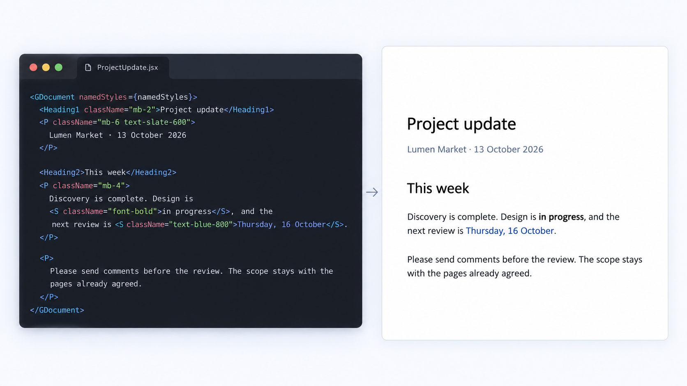
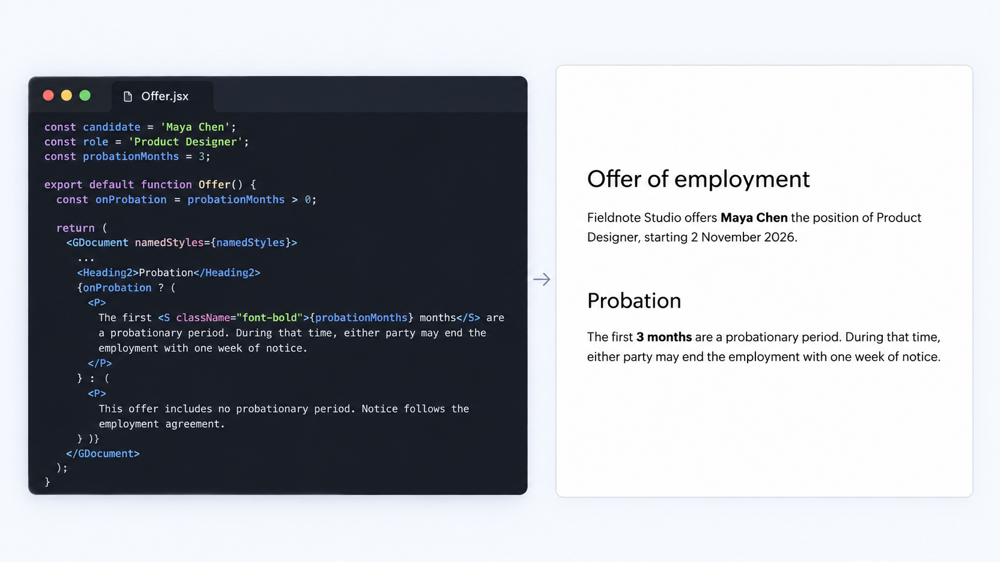
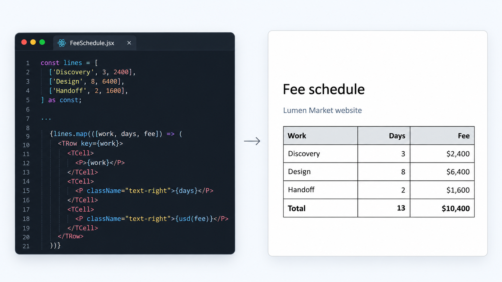

# react-gdoc



**Generate editable Google Docs with React and TypeScript.**

Build documents with JSX components, Tailwind-like styling, conditional logic, and data-driven tables. react-gdoc handles the Google Docs API `batchUpdate` requests, including the indexes and table offsets, so you don't have to.  

## Who is it for
Use it when your application needs **editable Google Docs**, not PDFs or static exports:

- **Document automation:** Generate reports, project updates, proposals, contracts, or schedules from application data.
- **Reusable templates:** Keep document layouts in React components, with TypeScript conditions for variations such as offers and agreements.
- **AI-agent workflows:** Use react-gdoc as the rendering layer while your application handles authentication and document delivery.

## Examples

### Rich text

**Style documents using familiar JSX and Tailwind-like classes.** Create project updates, reports, and other editable documents with headings, text formatting, colors, and spacing—without building Google Docs API requests by hand. The Tailwind-like syntax is familiar to AI coding agents, too.



```tsx
<Heading1 className="mb-2">Project update</Heading1>
<P className="mb-6 text-slate-600">Lumen Market · 13 October 2026</P>

<Heading2>This week</Heading2>
<P className="mb-4">
  Discovery is complete. Design is <S className="font-bold">in progress</S>, and the
  next review is <S className="text-blue-800">Thursday, 16 October</S>.
</P>
```

[View full example](examples/readme/rich-text.tsx)

### Document logic

**Use TypeScript to adapt a document to your data.** Build reusable templates for offer letters, agreements, or policies. JavaScript expressions and conditionals determine which sections appear in the resulting Google Doc.



```tsx
const probationMonths = 3;
const onProbation = probationMonths > 0;

{onProbation ? (
  <P>
    The first <S className="font-bold">{probationMonths} months</S> are a probationary period.
    During that time, either party may end the employment with one week of notice.
  </P>
) : (
  <P>
    This offer includes no probationary period. Notice follows the employment agreement.
  </P>
)}
```

[View full example](examples/readme/offer.tsx)

### Tables from data

**Turn application data into editable Google Docs tables.** Generate schedules, estimates, and table reports from arrays with `.map()`. Format values and align cells while react-gdoc takes care of Google Docs table indexes.



```tsx
const lines = [
  ['Discovery', 3, 2400],
  ['Design', 8, 6400],
  ['Handoff', 2, 1600],
] as const;

{lines.map(([work, days, fee]) => (
  <TRow key={work}>
    <TCell><P>{work}</P></TCell>
    <TCell><P className="text-right">{days}</P></TCell>
    <TCell><P className="text-right">{usd(fee)}</P></TCell>
  </TRow>
))}
```

[View full example](examples/readme/fee-schedule.tsx)

### Live preview: iterate without Google Docs API calls

In the cloned repository, preview your TSX in the browser with Vite hot reload. Iterate quickly without calling the Google Docs API.

```bash
npm run preview -- examples/readme/rich-text.tsx
```


## Quickstart

Install from GitHub (Node.js 20+, React 18+):

```bash
npm install github:janosbreuer/react-gdoc
```

`v0.1.0` pins this release:

```bash
npm install github:janosbreuer/react-gdoc#v0.1.0
```

Pass your application's Google authentication to `renderDocument()`:

```tsx
import { Heading1, P, renderDocument } from 'react-gdoc';

// `auth` is a Google OAuth2 or GoogleAuth client provided by your application.
const { documentId } = await renderDocument(
  <>
    <Heading1>Project update</Heading1>
    <P>Design is in progress.</P>
  </>,
  { auth, title: 'Project update' }
);
```

Pass `documentId` instead of `title` to replace an existing document's body. You can also supply a compatible Docs `client` instead of `auth`.

**Want to try the examples first?** Clone the repository, install dependencies, and run its CLI:

```bash
npm install
npm run render -- examples/readme/rich-text.tsx --title="Project update"
```

The CLI signs in through Google Desktop OAuth. Save your Google OAuth client as `credentials.json` in the directory where you run the command; the CLI stores its session in `token.json`. This file-based CLI sign-in is separate from the library API.

See the [Usage guide](docs/USAGE.md) for Google Cloud setup, supported components, styling, and authentication options.

## What works today

Headings, paragraphs, inline formatting, lists, tables, named styles, and a supported subset of Tailwind-like classes. Create new Google Docs or replace an existing document's body.

## License

MIT. Copyright Janos Breuer.